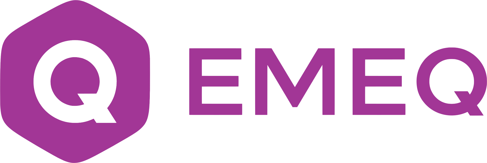

  <a href="https://emeq.nl">
    <picture>
      <source media="(prefers-color-scheme: dark)" srcset="https://raw.githubusercontent.com/emeqhq/.github/main/images/emeq-logo-dark.svg">
      
    </picture>
  </a>

# About Emeq

Emeq is a software company from Amsterdam. We build SaaS products for Dutch businesses, and one API that connects them to accounting and payment platforms.

#### Here, you can
- Use our open-source Laravel SDKs
- Open issues and pull requests on our public repos
- Report security issues privately at info@emeq.nl

# Products

## Emeq
Operations software for infrastructure and construction companies.

#### Related repos
- [emeq-mcp](https://github.com/emeqhq/emeq-mcp) - Laravel MCP server for Emeq apps

Learn more at [emeq.nl](https://emeq.nl).

## Planny
Planning and booking for driving schools, on web, iOS and Android.
[App Store](https://apps.apple.com/app/id6740007728) · [Google Play](https://play.google.com/store/apps/details?id=com.planny.app)

Learn more at [planny.nl](https://planny.nl).

## TheoriePlek
Online theory courses for car, motorbike and moped licences.

Learn more at [theorieplek.nl](https://theorieplek.nl).

## Emeq Hub
One API for Dutch accounting and payment platforms.

#### Related repos
- [emeq-hub-sdk](https://github.com/emeqhq/emeq-hub-sdk) - Laravel SDK for the Hub /v1 API
- [emeq-exact-api](https://github.com/emeqhq/emeq-exact-api) - Exact Online
- [emeq-snelstart-api](https://github.com/emeqhq/emeq-snelstart-api) - Snelstart
- [emeq-mollie-api](https://github.com/emeqhq/emeq-mollie-api) - Mollie, with multi-tenant credentials and OAuth
- [emeq-mistral-api](https://github.com/emeqhq/emeq-mistral-api) - Mistral AI (EU endpoint): OCR and chat
- [emeq-itheorie-api](https://github.com/emeqhq/emeq-itheorie-api) - iTheorie Connect API
- [emeq-dataforseo-api](https://github.com/emeqhq/emeq-dataforseo-api) - DataForSEO

Learn more at [hub.emeq.nl](https://hub.emeq.nl).

# Contact
info@emeq.nl · [LinkedIn](https://www.linkedin.com/company/emeq-bv)
